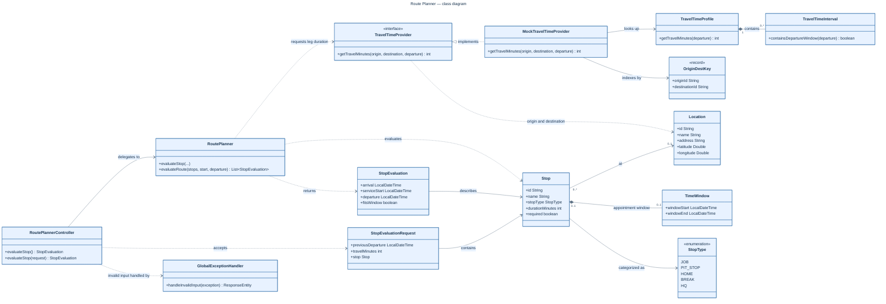

# 🗺️ Route Planner

> A Java + Spring Boot learning project for traffic-aware, multi-stop appointment scheduling.

Route Planner calculates when to arrive, start a visit, and depart while respecting appointment windows. It can evaluate a stop on its own or process a fixed sequence of stops using travel times supplied by a provider.

> **Project status:** learning prototype. Travel-time data is currently provided by a deterministic mock; there is no live maps, traffic, or route-optimization integration yet.

## ✨ What it does

- Calculates arrival, service start, and departure times for a stop.
- Waits when a traveler arrives before an appointment window opens.
- Checks whether service finishes by the window's end (finishing exactly at the end is allowed).
- Evaluates a fixed stop sequence, carrying each stop's departure time into the next leg.
- Selects mock travel durations by origin, destination, and departure-time interval.
- Exposes single-stop evaluation through a small Spring MVC REST API.
- Returns invalid input as HTTP `400 Bad Request`.

## 🧭 How it fits together

The controller accepts a request and delegates scheduling to `RoutePlanner`. For route evaluation, the planner asks a `TravelTimeProvider` for each leg's duration. The current Spring component, `MockTravelTimeProvider`, looks up a time-dependent profile. Stop data and appointment windows make up the domain model; each evaluation contains the resulting timing and window-fit status.



The diagram is also available as [Mermaid source](docs/architecture.mmd). The classes are in `src/main/java/com/neeraj/routeplanner/`.

## ⏱️ Scheduling behavior

For each stop, the planner:

1. Adds travel time to the previous departure to get the arrival time.
2. Starts service at arrival, or waits until the appointment window opens.
3. Adds the service duration to determine departure.
4. Marks the stop as fitting if departure is no later than the window end.

Without an appointment window, service starts immediately on arrival. Inputs such as negative durations, missing required values, and incomplete or reversed windows are rejected. The current implementation uses `LocalDateTime`; it does not perform timezone conversion.

## 🚀 Run locally

**Requirements:** JDK 17 or later. Maven is included through the wrapper.

```bash
git clone https://github.com/neemishrak/Route-Planner.git
cd Route-Planner
./mvnw spring-boot:run
```

The application starts on port `8080` by default. To run the test suite:

```bash
./mvnw test
```

On Windows, use `mvnw.cmd` instead of `./mvnw`.

## 🔌 API

### `GET /stops/evaluate`

Returns a demo stop evaluation.

```bash
curl http://localhost:8080/stops/evaluate
```

### `POST /stops/evaluate`

Provide the previous departure, travel duration in minutes, and stop details. The appointment window is optional.

```bash
curl -X POST http://localhost:8080/stops/evaluate \
  -H 'Content-Type: application/json' \
  -d '{
    "previousDeparture": "2026-10-25T23:30:00",
    "travelMinutes": 20,
    "stop": {
      "id": "SUP-1",
      "name": "Supplies",
      "stopType": "PIT_STOP",
      "durationMinutes": 30,
      "required": true,
      "timeWindow": {
        "windowStart": "2026-10-25T23:00:00",
        "windowEnd": "2026-10-26T00:20:00"
      }
    }
  }'
```

The response is a `StopEvaluation` containing the stop, `arrival`, `serviceStart`, `departure`, and `fitsWindow`. Invalid input is reported as HTTP `400` with an explanatory message.

## 🧱 Tech stack

- Java 17
- Spring Boot 4.1.2 and Spring Web MVC
- Maven Wrapper
- Java Time API (`LocalDateTime`)

## 🛣️ Next steps

Ideas for growing the prototype include richer route evaluation, stop-order optimization, timezone-aware scheduling, map visualization, and integration with a real traffic-aware routing provider.

---

Built as a hands-on project in scheduling, domain modeling, and Spring Boot APIs.
