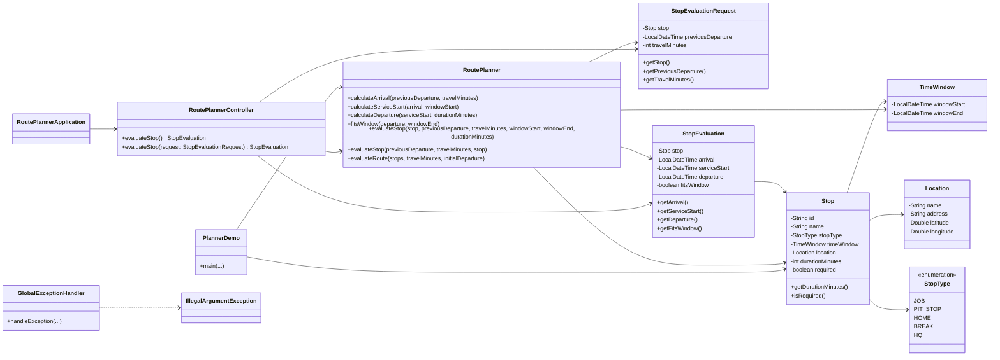
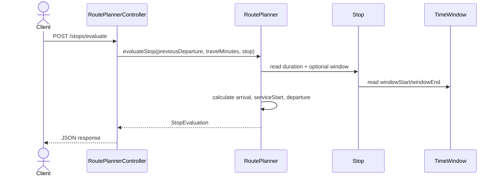

# Route Planner

A Java and Spring Boot learning project for a traffic-aware, multi-stop appointment and route planner. The implementation has evolved beyond a single-stop prototype into a small scheduling service that evaluates stop timings, validates appointment windows, and carries departure times through a fixed route.

## Latest changes

The project now includes:

- a Spring MVC controller with both demo and request-driven stop evaluation endpoints
- validation for missing times, negative durations, and invalid appointment windows
- a reusable `RoutePlanner` service with:
  - `calculateArrival(...)`
  - `calculateServiceStart(...)`
  - `calculateDeparture(...)`
  - `fitsWindow(...)`
  - `evaluateStop(...)` overloads
  - `evaluateRoute(...)` for a fixed stop sequence
- domain models for `Stop`, `Location`, `TimeWindow`, and `StopType`
- `StopEvaluation` and `StopEvaluationRequest` for API payloads
- centralized `GlobalExceptionHandler` for HTTP 400 responses on invalid input

## Highlights

- Evaluate a single stop using travel time, appointment window, and service duration
- Wait until the appointment window opens when the traveler arrives early
- Preserve local date/time values across midnight boundaries
- Reject invalid input such as missing times, negative durations, and reversed windows
- Evaluate a fixed route in sequence using each stop's departure as the next leg's starting point
- Expose the scheduling logic through a Spring Boot REST API

## Tech stack

- Java 17
- Spring Boot 4.1.2
- Maven Wrapper
- Spring Web MVC
- Java Time API (`java.time.LocalDateTime`)

## Architecture

The application follows a small layered architecture: HTTP handling in the controller, scheduling logic in the service layer, and domain modeling for route and time-window concepts.





### Layer responsibilities

- `RoutePlannerController`: exposes the API endpoints and delegates scheduling work.
- `RoutePlanner`: contains the core logic for evaluating arrival, service start, departure, window fit, and route sequences.
- `Stop`, `Location`, `TimeWindow`, `StopType`: represent route and appointment domain concepts.
- `StopEvaluation`: the result returned to API callers.
- `StopEvaluationRequest`: inbound request payload for `/stops/evaluate`.
- `GlobalExceptionHandler`: converts invalid inputs into readable HTTP 400 responses.

## Project structure

```text
Route-Planner/
├── src/
│   ├── main/
│   │   ├── java/com/neeraj/routeplanner/
│   │   │   ├── GlobalExceptionHandler.java
│   │   │   ├── Location.java
│   │   │   ├── PlannerDemo.java
│   │   │   ├── RoutePlanner.java
│   │   │   ├── RoutePlannerApplication.java
│   │   │   ├── RoutePlannerController.java
│   │   │   ├── Stop.java
│   │   │   ├── StopEvaluation.java
│   │   │   ├── StopEvaluationRequest.java
│   │   │   ├── StopType.java
│   │   │   └── TimeWindow.java
│   │   └── resources/
│   │       └── application.properties
│   └── test/java/com/neeraj/routeplanner/
│       └── RoutePlannerApplicationTests.java
├── .mvn/
├── .gitattributes
├── .gitignore
├── mvnw
├── mvnw.cmd
├── pom.xml
├── README.md
└── .github/ (if added later)
```

## Core functionality

The planner currently supports the following behaviors:

### Single-stop evaluation

`RoutePlanner.evaluateStop(...)` evaluates a stop using:

- `previousDeparture`: the departure time from the preceding location
- `travelMinutes`: duration to reach the stop
- `windowStart`: earliest allowed service start time
- `windowEnd`: latest allowed service completion time
- `durationMinutes`: time required for the appointment or service

The logic does the following:

1. calculates arrival from the previous departure and travel time
2. waits until the appointment window opens when arriving early
3. adds service duration to determine the departure time
4. verifies whether the departure stays inside the appointment window
5. rejects invalid values with validation errors

Appointment windows are optional. When both boundaries are missing, service starts on arrival and `fitsWindow` is `true`. Supplying only one boundary returns HTTP 400.

### Fixed-route evaluation

`RoutePlanner.evaluateRoute(...)` evaluates a route in a fixed visiting order and carries each stop's departure time into the next leg. This is a first step toward multi-stop planning without yet performing route optimization.

### Domain model

The codebase includes:

- `Stop`: a route location with type, time window, duration, and required flag
- `Location`: a physical point with name/address and optional coordinates
- `TimeWindow`: appointment start and end times
- `StopType`: stop categories such as `JOB`, `PIT_STOP`, `HOME`, `BREAK`, `HQ`
- `StopEvaluation`: result object containing `arrival`, `serviceStart`, `departure`, and `fitsWindow`

## Run locally

Requirements:

- JDK 17 or later

```bash
git clone https://github.com/neemishrak/Route-Planner.git
cd Route-Planner
./mvnw spring-boot:run
```

The application runs on port `8080` by default.

## API endpoints

### GET `/stops/evaluate`

This endpoint provides a demo evaluation using fixed sample values.

```bash
curl http://localhost:8080/stops/evaluate
```

Example response:

```json
{
  "arrival": "2026-10-25T09:20:00",
  "serviceStart": "2026-10-25T09:30:00",
  "departure": "2026-10-25T10:15:00",
  "fitsWindow": true
}
```

### POST `/stops/evaluate`

Send a JSON body like the example below:

```bash
curl -i -X POST http://localhost:8080/stops/evaluate \
  -H "Content-Type: application/json" \
  -d '{
    "previousDeparture": "2026-10-25T23:30",
    "travelMinutes": 20,
    "windowStart": "2026-10-25T23:00",
    "windowEnd": "2026-10-26T00:20",
    "durationMinutes": 30
  }'
```

Example response:

```json
{
  "arrival": "2026-10-25T23:50:00",
  "serviceStart": "2026-10-25T23:50:00",
  "departure": "2026-10-26T00:20:00",
  "fitsWindow": true
}
```

The system allows a service to end exactly at the window end.

### Validation errors

Invalid requests return HTTP 400 with a plain-text message from `GlobalExceptionHandler`.

Examples:

- missing `previousDeparture`
- negative `travelMinutes` or `durationMinutes`
- only one of `windowStart` and `windowEnd` supplied
- `windowEnd` before `windowStart`

## Current status

This repository is a working learning prototype for route scheduling logic. The most mature behavior is the time-window evaluation flow for single stops and fixed-order route evaluation. It is intentionally focused on deterministic timing logic rather than full optimization.

## Roadmap

Planned next steps include:

- evaluate multiple stops in a fixed sequence with richer route context
- add deterministic mock travel estimates
- explore stop-order search with backtracking and pruning
- investigate dynamic programming for route feasibility states
- add a map-based or UI-based visualization layer
- integrate real traffic-aware routing providers
- support timezone-aware scheduling

## Learning goals

This project is being built as a learning-first implementation focused on:

- Java fundamentals and clean object modeling
- Spring Boot and MVC APIs
- domain modeling for route and scheduling problems
- algorithmic thinking for route planning and optimization
- practical experience with validation and testing

## Notes

The current design is intentionally incremental:

- travel time is supplied by the caller instead of being fetched from a traffic provider
- route composition is not yet multi-stop optimized
- actual map integration and timezone-aware scheduling are future work
